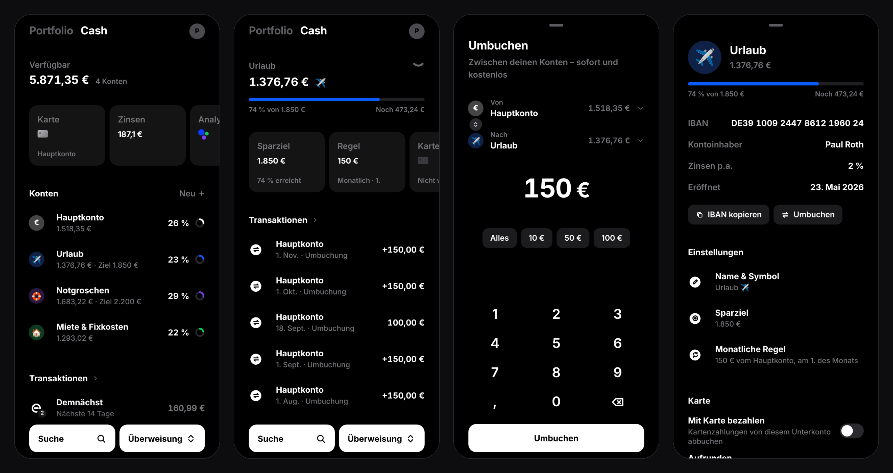

# Cash-Unterkonten · Klick-Prototyp

Funktionaler Dummy einer Neobroker-App im Handy-Format, gebaut um das **ausgedachte Feature „Unterkonten im Cash-Bereich“** zu präsentieren.
Alle Namen, Beträge, Kurse und IBANs sind zufällig erzeugt. Es gibt kein Login, kein Backend und keine echten Daten – der Prototyp steht in keiner Verbindung zu einem echten Anbieter.



## Starten

- **Am Rechner:** `index.html` im Browser öffnen. Die App erscheint in einem Handy-Rahmen.
- **Am Handy:** Die Datei hosten (z. B. GitHub Pages: *Settings → Pages → Branch auswählen*) und die URL öffnen. Über „Zum Home-Bildschirm“ läuft sie im Vollbild ohne Browserleiste.

`index.html` ist eine einzelne, eigenständige Datei (CSS und JS inline) und funktioniert auch offline.

## Zufallsdaten

- Beim ersten Öffnen wird ein Datensatz gewürfelt und im Browser gespeichert, damit er während der Präsentation stabil bleibt.
- **Profil (Avatar oben rechts) → Demo → „Neue Zufallsdaten“** würfelt neu.
- **„Ohne Unterkonten starten“** zeigt den Einstieg ins Feature (nur Hauptkonto + Hinweiskarte).
- Mit `index.html?seed=1234` lässt sich ein fester Datensatz erzwingen (gleicher Seed = gleiche Namen und Zahlen).

## Das Feature: Unterkonten

| Wo | Was |
| --- | --- |
| Cash → „Konten“ | Übersicht aller Konten mit Saldo und Anteil am gesamten Cash, „Neu +“ legt ein Unterkonto an |
| Tippen auf ein Konto | Eigene Ansicht je Unterkonto: Saldo, Sparziel-Fortschritt, Transaktionen, eigene IBAN. Der Pfeil oben rechts führt zurück zur Übersicht |
| „Überweisung“ → „Umbuchen“ | Geld sofort zwischen Konten verschieben (Konten wählbar, Tauschen-Knopf, Schnellbeträge) |
| Karten im Unterkonto | Sparziel, monatliche Regel (Dauerauftrag vom Hauptkonto), Kartenverknüpfung, Details |
| Karte | Auswählen, von welchem Konto Kartenzahlungen abgebucht werden, und in welches Unterkonto aufgerundet wird. „Kartenzahlung simulieren“ zeigt das live |
| Details | IBAN kopieren, Name/Symbol ändern, Unterkonto schließen (Guthaben geht zurück aufs Hauptkonto) |
| Transaktionen, Statistik | Filter-Chips je Konto |
| Kaufen, Sparpläne | „Zahlen mit“ lässt ein Unterkonto als Quelle wählen |

Der Rest der App (Portfolio mit Chart, Suche, Wertpapier-Details, Kaufen/Verkaufen, Sparpläne, Zinsen, Statistik, Profil) ist ebenfalls klickbar, damit der Kontext stimmt.

### Vorschlag für den Ablauf einer Demo

1. Profil → „Ohne Unterkonten starten“ → Cash zeigt die Hinweiskarte.
2. Unterkonto eröffnen (z. B. „Urlaub“), Sparziel setzen, Geld umbuchen.
3. Monatliche Regel anlegen → erscheint unter „Demnächst“.
4. Karte → Aufrunden aktivieren → „Kartenzahlung simulieren“.
5. Zurück zur Übersicht: Split aller Konten, Transaktionen und Statistik je Konto filtern.

## Entwicklung

```
src/index.html      Grundgerüst
src/styles.css      Styling
src/js/util.js      Zufall (Seed), Formatierung, Icons
src/js/data.js      Datenpools und Generator
src/js/store.js     Zustand, Speicherung, Aktionen auf den Daten
src/js/charts.js    Kursverläufe und SVG-Charts
src/js/views.js     Hauptansichten (Portfolio, Cash, Profil)
src/js/sheets.js    Alle Sheets (Transaktionen, Umbuchen, Suche, …)
src/js/app.js       Rendering, Events, Sheet-Stack
```

Zum Entwickeln `src/index.html` direkt öffnen. `node build.mjs` schreibt daraus die einzelne `index.html` im Hauptverzeichnis (keine Abhängigkeiten nötig).
